# satelle workflow (project) — the agent model, authored in DOT

> **This is a project workflow** under `.satelle/workflows`, the ACTIVE workflow
> for the adopting repo: a project-scope workflow takes precedence over the binary's
> embedded **system** default `satelle-baseline-workflow`. See the
> `satelle-repo-agnostic` and `satelle-agent-model` principles.

The lifecycle is the **DOT graph** below — read it as the authority; this prose
only orients and must not restate it. Each node is a step carrying an `agent`.
This workflow is **reviewer-first** (a reviewer gates every transition). **Plan**
dispatches to an isolated read-only `planner`; **in_progress**, **integration**,
and **release** run **in-loop** on the driving session (`agent=executor`) so the
session performs the work with its normal context, principles, and tools — not a
fresh isolated worker subprocess. The driving session orchestrates transitions,
performs the executor stages, and lets the gates judge.

`plan` stays on its own read-only binding because it is entered from the
non-performing `backlog` state, and the dispatch lock-guard refuses a code-writer
dispatched from a non-performing state. A **reviewer** node only gates *entry*
via its `prompt="@skill:NAME"` (read-only — it judges, never mutates). Status
advances only through a reviewer's accept. The gating begins at intake:
`backlog -> plan` is gated by `satelle-story-intent-review`. A reject leaves the
story at `backlog` to be fixed and re-requested (or cancelled via
`backlog -> cancelled`).

Two things the edges don't show. **There is no deploy state** — pushing to `main`
IS the release, verified by CI. And the **always-on gates are declared, not
injected**: the edge-less reviewer nodes `estimate` (`on="in_progress,done"`) and
`intcheck` (`on="release"`) run on the transitions their `on=` names, so the DOT is
the sole gating authority. `estimate` requires a plan estimate entering
`in_progress` and an actual entering `done`; `intcheck` runs `make integration  # example: your local integration suite command` on
entry to `release` (the `integration -> release` edge), alongside that edge's
`satelle-integration-review` — so `integration` is a **visible testing step**, not a
gate hidden inside another transition (<story-id>). The `integration -> in_progress`
and `release -> in_progress` edges are recovery: a reject returns the story to work
to fix and re-traverse, never bypass.

```dot
digraph satelle_workflow {
  graph [goal="Drive a story to done — plan reviewed against the ACs, implemented in-loop, released and verified by CI, every gate accepted", vars="story, repo_root"]
  rankdir=LR

  backlog     [shape=Mdiamond]
  plan        [agent=planner, prompt="@skill:plan"]     // DISPATCHED: isolated read-only planner
  in_progress [agent=executor, prompt="@skill:code"]    // IN-LOOP: driving session implements
  integration [agent=executor, prompt="@skill:integrate"] // IN-LOOP: driving session tests
  release     [agent=executor, prompt="@skill:release"] // IN-LOOP: driving session releases
  // Terminal success. Nothing fires on entry: under FLAT DISPATCH the
  // orchestrator is the sole scheduler, so the lessons corpus is captured by the
  // orchestrator running `satelle story retrospect <id> --session <session>` after close, not by the
  // state dispatching an agent at itself.
  done        [shape=Msquare]
  cancelled   [agent=reviewer, prompt="@skill:satelle-story-cancel-review"]
  // blocked is a park state (not engaged): world-not-ready, same ACs on resume.
  // agent=reviewer so the edit/commit gates do not treat it as engaged work.
  // Entry dispatches NOTHING (<story-id>): the orchestrator consults
  // [blocked-triage] under @skill:satelle-story-blocked-triage when it parks a
  // story, and records the advice so the blocked-review gate judges it.
  blocked     [agent=reviewer, prompt="@skill:satelle-story-blocked-review", from="*"]

  // step opts this workflow into per-transition step summaries (<story-id>):
  // an edge-less declaration, mandatory so a summary failure is surfaced.
  step        [agent=reviewer, prompt="@skill:satelle-step-summary", mandatory=true]

  // Declared scoped reviewers (edge-less, on="<target states>"): always-on gates the
  // workflow itself declares. estimate gates begin-work + close; intcheck runs
  // `make integration  # example: your local integration suite command` on entry to release — i.e. on the integration -> release edge,
  // alongside that edge's satelle-integration-review — so integration is a VISIBLE step.
  // estimate: tags only. Producer = driving session (not planner):
  //   satelle story estimate before in_progress --session <session>; satelle story actual before done. --session <session>
  // See @skill:plan and documents/estimate-and-lessons.md (<story-id>).
  estimate    [agent=reviewer, prompt="@skill:satelle-estimate-actual-review", on="in_progress,done"]
  intcheck    [agent=reviewer, prompt="@skill:satelle-integration-check", on="release"]
  // changelogcheck fails closed on release→done when CHANGELOG.md has no entry
  // for the version on HEAD (<story-id>).
  changelogcheck [agent=reviewer, prompt="@skill:satelle-changelog-entry-check", on="done"]
  // design: surface-scoped UI design-system gate (<story-id> / epic:surface-scoped-steps).
  // Enqueued only for surface:ui stories on entry to integration — same spine for all.
  design [agent=reviewer, prompt="@skill:satelle-design-review", on="integration", applies_to="surface:ui"]

  backlog     -> plan         [agent=reviewer, prompt="@skill:satelle-story-intent-review"] // intake gate: a story must pass intent-review to enter plan
  // Multi-reviewer plan gate: plan-review + architecture + integration-coverage,
  // concurrent (parallel=true) — all-must-accept, no short-circuit (<story-id>).
  plan        -> in_progress  [agent=reviewer, prompt="@skill:satelle-story-plan-review,satelle-story-architecture-review,satelle-story-integration-coverage-review", parallel=true]
  // code-ac then scope then workflow-change (CSV). scope uses engagement
  // baseline + story diff (<story-id>). workflow-change n/a-fast-accepts when
  // the slice touches no workflow file (<story-id>).
  in_progress -> integration  [agent=reviewer, prompt="@skill:satelle-code-ac-review,satelle-story-scope-review,satelle-workflow-change-review"]
  integration -> release      [agent=reviewer, prompt="@skill:satelle-integration-review"] // tests adequate (+ scoped intcheck runs make integration  # example: your local integration suite command) -> enter release
  release     -> done         [agent=reviewer, prompt="@skill:satelle-story-release-review"]

  integration -> in_progress  // recovery: a test/review reject returns to work
  release     -> in_progress  // recovery: a release/done reject returns to work

  // Park / resume: world-not-ready (reason gated on entry). Resume is agent-directed.
  backlog     -> cancelled
  plan        -> cancelled
  in_progress -> cancelled
  blocked     -> cancelled
  integration -> cancelled
  release     -> cancelled
}
```



## Skill resolution

Every gate/skill this workflow names resolves through the doc-index, **project
scope (`.satelle/skills`) layered over the embedded system defaults**. The
dispatched `plan` (`@skill:plan`), and the in-loop `in_progress` (`@skill:code`),
`integration` (`@skill:integrate`) and `release` (`@skill:release`) rubrics, and
the reviewer gates (`satelle-story-intent-review`, `satelle-story-plan-review`,
`satelle-code-ac-review`, `satelle-integration-review`, `satelle-integration-check`,
`satelle-story-release-review`, `satelle-estimate-actual-review`,
`satelle-story-cancel-review`, `satelle-step-summary`), and the post-release
lessons capture (`satelle-lessons`, run by the ORCHESTRATOR after close via
`satelle story retrospect <id> --session <session>` on the
`[retrospective]` binding) are authored in the adopting repo's `.satelle/skills` — so
there is no dangling `@skill:` reference and a story drives to a terminal state
without a missing-skill block. `satelle-workflow-change-review` (CSV sibling on
`in_progress → integration`) resolves from the **embedded** substrate (not
repo-authored). Reviewer gates degrade to advisory only if their rubric is
genuinely absent. Lessons are offline corpus (not session-injected).

## Environment

```yaml
guardrails:
  always:
    - Drive an engaged item to a terminal state (done or cancelled) — don't leave work open indefinitely.
    - Give a story numbered acceptance criteria before starting, and satisfy them before moving to done.
    - Dispatch only the plan stage to the isolated planner; perform in_progress, integration, and release in-loop as the driving session (agent=executor); let reviewer gates judge every transition.
    - Bump the version + commit + push + record the release in the in-loop release step; the release gate verifies the bump, CI, the published release, and the acceptance criteria before close.
  ask_first: []
  never:
    - Place any state after done — done is always the terminal success state.
    - Self-enact a gated edge the reviewer has not accepted.
    - Mark an item done with unmet acceptance criteria, or release with a failing CI run.
    - Re-dispatch in_progress / integration / release to an isolated worker when this workflow assigns them to the executor — those stages stay in-session.
```
